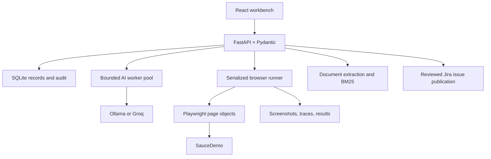

# Architecture and implementation decisions

## System boundary

The packaged React frontend is served by the same FastAPI process as the API. In development, Vite proxies API calls to FastAPI. SQLite stores requirements, cases, revisions, datasets, runs, chats, documents, defects and audit events. Generated records persist across application restarts. Browser artifacts live under `runtime/evidence/<run-id>`.

## Requirement-to-result lineage

1. A source text and model configuration are submitted.
2. The AI returns a Pydantic-validated analysis. Server-generated requirement IDs replace any need for the model to invent IDs.
3. The model receives those exact IDs, source text and supported automation contracts when designing cases.
4. Cases are checked for known requirement IDs, verbatim source quotes, duplicate steps and required adapter data. They remain drafts.
5. A reviewer verifies semantic correctness, assumptions and whether the case exactly matches its adapter. The approval note is required.
6. The runner snapshots each approved case into its execution plan. Editing a case later resets its latest execution state and preserves a revision; historical runs retain their own approved snapshot.
7. A result captures individual dataset identity, performed steps, assertion error or success evidence, timing, current URL, JavaScript errors, screenshot and trace.
8. Failure analysis uses that actual result. A defect links back to run and result IDs. A linked test stores its defect IDs.
9. RTM metrics separately count designed, approved, automatable, executed and passed cases. Curated smoke tests do not falsely count as execution of generated cases.

## Why these choices?

| Decision | Reason | Tradeoff |
|---|---|---|
| Python Playwright | Matches Python learning path; good assertions, traces, isolated contexts and stable locators | Chromium only in this version |
| Sync API in worker thread | Keeps browser work off API request threads and avoids Windows async subprocess-loop problems | One run at a time |
| Two AI worker threads | Long local inference does not block UI requests | In-memory queue; pending work is marked interrupted on restart |
| Pydantic schemas | Enforces complete, typed artifacts | A schema cannot prove the truth of a claim |
| Controlled workflow adapters | Auditable execution without running arbitrary model code | Unsupported generated scenarios remain manual |
| Separate script drafts | Demonstrates AI-assisted automation authoring with human inspection | Scripts require review before independent execution |
| SQLite | No database service installation; portable and easy to explain | Single-user local scope; not a concurrent multi-tenant platform |
| BM25 retrieval | No embedding model download or additional vector service | Synonyms and paraphrases can retrieve poorly; no semantic search |
| Server `.env` secrets | Keys never need to enter browser storage | Restart needed after configuration changes |
| Same-origin packaged UI | One startup command and no production CORS setup | Frontend must be rebuilt after source edits |

## AI boundaries

`ai.py` uses a shared system instruction and task-specific user context. The schema is supplied to the model. Ollama receives the JSON schema in `format`; Groq uses JSON object mode plus explicit schema instructions. Pydantic validates both. A malformed response gets one repair attempt, then an error. There is no silent provider fallback because that could transfer local data to the cloud unexpectedly.

The selected provider, model, temperature, token limit, prompt version, latency, attempt count, system prompt, supplied context and parsed output are retained for inspection. Source documents are explicitly treated as untrusted data. This reduces prompt-injection risk; it does not mathematically guarantee resistance.

## Document flow

Uploads are size-limited and type-limited. Text PDFs support at most 100 pages and 250,000 extracted characters. DOCX expansion is bounded. Scans without text are rejected with an OCR explanation. Chunks are 1,200 characters with 200-character overlap, preserving PDF page number or a section marker for non-PDF formats.

BM25 ranks excerpts from only the selected document. Questions with no lexical matches abstain without calling an LLM. If the model returns missing or invalid citation IDs, the answer is withheld. Matching citation IDs do not prove that every factual claim is entailed; the UI exposes excerpts for review. Document-derived tests use source quotes and remain manual.

The document report collects metadata, Q&A, retrieval excerpts, AI provenance, analyses and test cases. It does not claim to have analyzed every page when only focused excerpts were retrieved.

## Automation contracts

| Adapter | Executed behavior |
|---|---|
| `login_valid` | Submit given credentials; assert inventory URL and six products |
| `login_invalid` | Submit given credentials; assert visible error and optional expected substring; login remains visible |
| `cart_add` | Login, add exact product, verify Remove button, badge of 1, and cart item |
| `checkout` | Login, add one product, fill three checkout fields, verify total and final confirmation |
| `logout` | Login, open menu, logout and verify login button |
| `manual` | No browser execution |

The human-written steps are not interpreted as arbitrary actions. The UI exposes the adapter contract, and the reviewer confirms equivalence. For example, a sorting scenario must not be approved with `cart_add`. New behaviors should be implemented as new page-object methods and adapter contracts, with meaningful checks.

## Failure and Jira semantics

Failure analysis receives text assertions, steps, dataset, URL and console errors. Screenshots and traces are evidence for the human; no vision model claim is made. Root causes remain hypotheses. Deliberate failure demonstrations are forced to retain the injected classification and title prefix.

Jira publication requires an approved defect and explicit UI confirmation. A process lock prevents concurrent duplicate submissions. A successful issue key is reused on repeated requests. If a network timeout creates an uncertain outcome, publication becomes `unknown` and is blocked from blind retry. This is local duplicate protection, not distributed idempotency across multiple application instances.

Jira custom fields and attachment uploads are intentionally outside the implemented scope. The report remains useful without Jira credentials.

## Security and deployment

Run on localhost only. The product has no authentication and is not suitable for public exposure. Untrusted origins are rejected for writes, exports escape HTML, and CSV formulas are neutralized. Evidence filenames are allowlisted. SQL uses parameters. No generated code is evaluated. File-size limits reduce resource misuse but do not replace comprehensive file sandboxing or malware scanning.

`runtime/` contains the user's source text and AI artifacts. Treat it according to the content's sensitivity. Delete or archive it only intentionally. Back it up with the server stopped. Real cloud keys should never be pasted into the UI, prompts or source.
